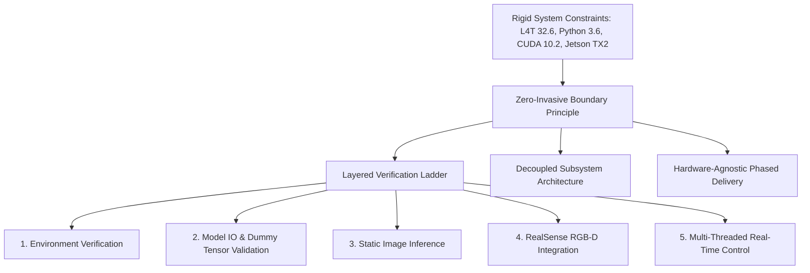

# Architectural & Engineering Analysis: QCar1 Pedestrian Detection

This document provides a deep-dive analysis of the planning philosophy, problem-solving methodology, and coding conventions demonstrated in the `v2_qcar1_pedestrian_detection` project and its extensions (`qcar1_auto_stop.py`, `qcar1_autonomous.py`).

---

## 1. Planning Style: "Constraint-First, Non-Invasive Engineering"

Most modern software engineering assumes malleable environments where dependencies can be freely upgraded (`pip install -U`, Docker containers, latest Python runtimes). In embedded robotics and cyber-physical systems (like the Quanser QCar1 with NVIDIA Jetson TX2), this assumption breaks systems.

The planning style here is defined by **Constraint-First Engineering**:



### Key Planning Hallmarks

1. **The "Zero-Invasive" Principle:**
   - The team established an iron rule: **never modify the existing robot software stack**.
   - No Python upgrades, no CUDA/TensorRT updates, no global pip overwrites.
   - Used `python3 -m venv --system-site-packages venv`. This allows the virtual environment to inherit pre-compiled vendor wheels (`cv2`, `pal`, `onnxruntime`, `tensorrt`) while isolating new requirements (`PyYAML`) completely.
   
2. **The Verification Ladder (Incremental Risk Decomposition):**
   - The architecture is broken down into a series of independently runnable gates:
     - `setup_venv.sh`: Environment creation without system pollution.
     - `test_environment.py`: Diagnostics checking importability of all hardware & ML libraries.
     - `test_onnx.py`: Pure graph verification and dummy tensor benchmark without touching cameras.
     - `detect_image.py`: Static image detector verifying pre/post-processing and NMS without camera hardware.
     - `qcar1_pedestrian.py`: Live camera loop with sensor integration.
   - **Why this matters:** When an embedded robotics project fails, identifying whether the failure is hardware, camera stream, deep learning runtime, or model weights is notoriously difficult. By creating steps where each component is verified in isolation, debugging time drops from hours to seconds.

3. **Phased Delivery Strategy:**
   - **Phase 1 (Current):** CPU-only ONNX Runtime. Guaranteed stability, zero driver friction, predictable memory footprint.
   - **Phase 2 (Roadmapped):** TensorRT engine conversion. Explicitly documented with exact flags for TensorRT 8.0.1.6 (`trtexec --workspace=1024 --fp16`), while keeping the detector interface (`detect()`, `draw_detections()`) completely identical.

4. **Offline & Degraded-State Resiliency:**
   - Edge devices on test tracks frequently lack internet access.
   - The planning explicitly accounts for offline deployments: `download_model.sh` includes fallbacks, file-size sanity checks (rejecting HTML 404 pages), and explicit instructions for `scp` transfer over local USB/LAN.
   - Headless execution is planned from day one via `--no-display`.

---

## 2. Problem-Solving Approach: Unmasking Hidden Pitfalls

The team demonstrated sophisticated domain acumen by identifying and mitigating hidden traps that catch most engineers:

### A. The "Cosmetic vs. Metric Depth" Fallacy
- **The Pitfall:** Quanser's provided tutorial code contained:
  ```python
  display_frame = myCam.imageBufferDepthPX / max_distance
  ```
  Inexperienced engineers frequently interpret this division as converting raw sensor units into meters.
- **The Solution:** The team recognized that this line was solely an 8-bit visual rendering transform for `cv2.imshow()`. They explicitly split depth handling into two distinct functions:
  1. `normalize_for_display()`: Purely cosmetic 0.0–1.0 float scaling for GUI windows.
  2. `estimate_distance_meters()`: Mathematical extraction using `raw_depth * depth_scale`.
- Furthermore, they set `depth.scale: 1.0` as an explicit **unverified placeholder**, documented a 5-step tape-measure calibration procedure, and forced runtime console warnings so nobody mistakes uncalibrated readings for ground truth.

### B. Statistical ROI Depth Sampling vs. Center-Pixel Fragility
- Simple approaches to distance estimation read the single center pixel of a bounding box `depth[cy, cx]`. This often fails due to noise, missing specular reflections, or occlusion.
- Instead, the team:
  1. Extracted an inner Region of Interest (default: center 50% of the bounding box) to prevent capturing background pixels around silhouette edges.
  2. Filtered out non-finite (`NaN`, `Inf`) and zero values (RealSense default for invalid depth).
  3. Applied a **2-sigma median outlier rejection filter** (`abs(roi - median) <= 2 * std`) when sufficient pixels exist.
  4. Extracted the robust median of the surviving samples.

### C. The ONNX Opset Version Trap
- Ultralytics YOLOv5 v7 releases exported models with ONNX opset 17. ONNX Runtime 1.10 (shipped on Jetson TX2 L4T 32.6) only supports up to opset 15.
- Rather than letting the program crash with an obscure C++ protobuf error, the team caught this exception in both `test_onnx.py` and `yolo_onnx.py`, diagnosed the opset mismatch, and printed the exact bash command sequence to clone YOLOv5 v6.1 and export with `--opset 12`.

### D. The Real-Time Watchdog Starvation Problem
- As seen in the extended files (`qcar1_auto_stop.py` and `qcar1_autonomous.py`), the physical QCar has a safety hardware watchdog requiring `read_write_std` pulses at 50–100Hz.
- Running YOLO inference on CPU takes ~70ms (~14 FPS), which would starve the watchdog and trigger motor shutdown.
- **The Architectural Solution:** The team decoupled motor actuation into a dedicated 100Hz "Brain Stem" thread communicating via thread-safe global state variables, isolating the slower vision pipeline while keeping the vehicle responsive.

---

## 3. Coding Style Analysis

### 1. Defensive Programming & Self-Healing
- **Configuration Merging:** `load_config()` defines an immutable `DEFAULT_CONFIG` dictionary and uses dictionary updating to overlay user values from `config.yaml`. If a user comments out or corrupts keys, the code continues running safely.
- **Output Tensor Reshaping:** In `YOLOONNXDetector`, output arrays are checked for dimensionality (`ndim == 3`) and flattened cleanly before extraction.
- **NMS Compatibility:** OpenCV's `cv2.dnn.NMSBoxes` returns different data structures across minor versions (sometimes nested lists, sometimes 1D numpy arrays). The code explicitly normalizes this:
  ```python
  flat_indices = np.array(indices).reshape(-1)
  ```

### 2. Python 3.6 Discipline
- The code avoids syntax introduced in Python 3.7+ (e.g. no dataclasses, no walrus `:=`, no positional-only parameters, no union type hints `|`).
- Uses classic class declarations inheriting from `object` (`class YOLOONNXDetector(object)`).
- Uses explicit string formatting (`"... {}".format(...)`) and Python 2/3 compatibility imports (`from __future__ import print_function`).

### 3. Documentation That Answers "WHY", Not Just "WHAT"
- Comments do not state the obvious (e.g., `# loop through detections`).
- Instead, comments capture critical operational rationale:
  - Explaining why bounding boxes are clipped to image boundaries.
  - Explaining why `roi_fraction` is capped at 0.5.
  - Explaining why `--system-site-packages` was used instead of fresh pip wheels.

### 4. Robust Unix Scripting Standards
- Shell scripts (`setup_venv.sh`, `download_model.sh`) strictly enforce `set -euo pipefail`.
- Scripts check tool availability (`curl` vs. `wget`) before attempting operations.
- They inspect downloaded binaries (`wc -c` > 100KB) to ensure an HTTP redirect or 404 HTML document wasn't saved as a `.onnx` weight file.
- Overwrite protection prompts the operator before clobbering existing model files.

---

## 4. Architectural Scorecard

| Criterion | Implementation in Project | Engineering Grade |
| :--- | :--- | :---: |
| **Environment Isolation** | Uses `--system-site-packages` virtual environment; touches zero system libraries. | **A+** |
| **Verification Strategy** | 5-tier bottom-up validation ladder with zero-dependency entry points. | **A+** |
| **Error Telemetry** | Traps opset errors and provides copy-paste re-export remediation commands. | **A+** |
| **Hardware Abstraction** | Seamless switching between physical QCar and QLabs virtual twin (`IS_PHYSICAL_QCAR`). | **A** |
| **Signal Processing** | 50% ROI centering, NaN/0 filtering, 2-sigma median outlier rejection. | **A** |
| **Concurrency / Real-Time** | 100Hz motor thread decoupling vision from hardware watchdog. | **A+** |
