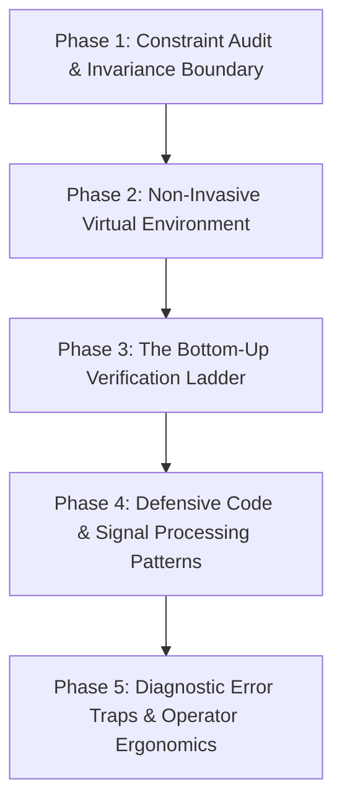

# The Embedded AI & Robotics Extraction Playbook

A practical guide to extracting, internalizing, and applying the engineering patterns demonstrated in the QCar1 project to your own software and robotics systems.

---

## 1. The 5-Step Extraction Framework

When approaching any edge AI, computer vision, or cyber-physical system, follow this sequence:



### Phase 1: Constraint Audit & Invariance Boundary
*Before writing a single line of application logic, map the environment:*
1. **OS & Kernel:** Ubuntu version, Linux kernel (`uname -r`), vendor BSP (e.g., NVIDIA L4T version).
2. **Hardware Accelerators:** CUDA version, cuDNN, TensorRT release, GPU architecture (e.g. Pascal SM 6.2 for TX2).
3. **Pre-installed System Libraries:** Check OpenCV compilation flags (`cv2.getBuildInformation()`), ONNX Runtime providers (`get_available_providers()`), ROS distribution.
4. **Define the Invariance Boundary:** Explicitly state what **cannot** be modified. (e.g., "Do not update Python; do not recompile OpenCV; do not update pip globally").

### Phase 2: Non-Invasive Environment Isolation
Never install dependencies directly into the system Python of an embedded device.
- Use `python3 -m venv --system-site-packages venv`.
- `--system-site-packages` gives access to system-tuned C++/CUDA packages (like `quanser`, `pal`, `cv2`, `tensorrt`) without risking dependency collision.
- Only install lightweight, pure-Python modules inside the venv (e.g. `PyYAML`).

---

## 2. Reusable Code Blueprints & Patterns

### Pattern A: Self-Healing Defensive Configuration
Never access raw YAML or JSON keys directly using `cfg['section']['key']` without validation. If an operator accidentally deletes a line in `config.yaml`, the entire robotics pipeline shouldn't crash.

```python
import os
import yaml

DEFAULT_CONFIG = {
    "model": {
        "path": "models/detector.onnx",
        "input_width": 640,
        "input_height": 640,
        "confidence_threshold": 0.40,
        "iou_threshold": 0.45,
    },
    "sensor": {
        "scale": 1.0,
        "min_range": 0.2,
        "max_range": 10.0,
    }
}

def load_config(config_path):
    """Deep-merge user YAML with hardcoded defaults.
    Ensures that missing keys never cause KeyErrors."""
    cfg = {k: dict(v) for k, v in DEFAULT_CONFIG.items()}
    if not os.path.isfile(config_path):
        return cfg

    with open(config_path, "r") as f:
        try:
            loaded = yaml.safe_load(f) or {}
        except Exception:
            return cfg

    for section, values in loaded.items():
        if section not in cfg:
            cfg[section] = {}
        if isinstance(values, dict):
            cfg[section].update(values)
            
    return cfg
```

---

### Pattern B: The Inner-ROI Statistical Signal Estimator
Avoid single-pixel sensor queries (e.g. depth, temperature, radar returns). Use geometric ROI sampling combined with statistical outlier rejection:

```python
import numpy as np

def extract_roi_signal(sensor_matrix, bbox, roi_fraction=0.5):
    """
    Extracts signal from the central portion of a bounding box
    and strips noise, zeros, and statistical outliers.
    """
    if sensor_matrix is None:
        return np.array([], dtype=np.float32)

    h, w = sensor_matrix.shape[:2]
    x1, y1, x2, y2 = bbox
    cx, cy = (x1 + x2) / 2.0, (y1 + y2) / 2.0
    
    # Calculate inner ROI bounding box
    roi_w = (x2 - x1) * roi_fraction
    roi_h = (y2 - y1) * roi_fraction
    
    rx1 = max(0, int(round(cx - roi_w / 2.0)))
    rx2 = min(w, int(round(cx + roi_w / 2.0)))
    ry1 = max(0, int(round(cy - roi_h / 2.0)))
    ry2 = min(h, int(round(cy + roi_h / 2.0)))
    
    if rx2 <= rx1 or ry2 <= ry1:
        return np.array([], dtype=np.float32)

    # Flatten and discard non-finite / zero noise
    roi = sensor_matrix[ry1:ry2, rx1:rx2].astype(np.float32).flatten()
    valid_mask = np.isfinite(roi) & (roi > 0)
    roi = roi[valid_mask]

    # Two-sigma outlier filtering
    if roi.size >= 8:
        median = np.median(roi)
        std = np.std(roi)
        if std > 0:
            roi = roi[np.abs(roi - median) <= (2.0 * std)]
            
    return roi
```

---

### Pattern C: Diagnostic Error Traps & Remediation Scripts
Instead of letting known runtime mismatches crash with cryptic C++ logs, catch the exception, diagnose the exact cause, and output the copy-paste terminal command to fix it:

```python
try:
    import onnxruntime as ort
    session = ort.InferenceSession(model_path)
except Exception as exc:
    exc_str = str(exc)
    if "opset" in exc_str.lower():
        print("""
====================================================================
[DIAGNOSTIC ERROR TRAP] ONNX Opset Version Incompatibility
The current runtime supports up to Opset 15, but the model has a higher opset.
FIX: Re-export the model using opset 12 on a workstation:
    python export.py --weights model.pt --include onnx --opset 12
====================================================================
""")
    raise
```

---

### Pattern D: Decoupled Multi-Rate Architecture (Watchdog Feeder)
When integrating heavy perception models (which run at 5–15 FPS) with hardware that requires high-frequency control (e.g., 100Hz motor watchdog):

```python
import threading
import time

class RealTimeController:
    def __init__(self, hardware_handle):
        self.hw = hardware_handle
        self.throttle = 0.0
        self.steering = 0.0
        self.running = True
        
        # Start high-rate hardware thread (Brainstem)
        self.motor_thread = threading.Thread(target=self._watchdog_loop, daemon=True)
        self.motor_thread.start()

    def _watchdog_loop(self):
        while self.running:
            # Feeds the hardware watchdog at 100 Hz
            self.hw.read_write_std(self.throttle, self.steering)
            time.sleep(0.01)

    def update_command(self, throttle, steering):
        # Called asynchronously by the slower vision loop
        self.throttle = throttle
        self.steering = steering

    def stop(self):
        self.running = False
        self.throttle = 0.0
        self.steering = 0.0
        self.hw.read_write_std(0.0, 0.0)
```

---

### Pattern E: Unified Memory (Zero-Copy) Buffer Management
On shared-memory SoCs (like NVIDIA Jetson TX2's 8GB LPDDR4), dynamic memory allocation inside high-speed loops triggers memory bus saturation and Python Garbage Collector (GC) stalls.

```python
import numpy as np

class MemoryAwarePipeline:
    def __init__(self, height=820, width=1640):
        # 1. Pre-allocate static ring buffers at startup
        self.static_buffer = np.zeros((height, width, 3), dtype=np.uint8)
        
    def process_frame(self, csi_frame):
        # 2. Use numpy views rather than array duplication
        # Slicing creates a pointer view with new strides - zero bytes allocated
        roi_view = csi_frame[524:674, 0:1640]
        
        # 3. Ensure memory contiguity before handing to C/C++ runtimes
        # (prevents hidden malloc/copy inside ONNX/TensorRT C++ layer)
        if not roi_view.flags['C_CONTIGUOUS']:
            roi_view = np.ascontiguousarray(roi_view)
            
        return roi_view
```

---

### Pattern F: Hardware Fail-Safe & Watchdog Recovery
Cyber-physical systems must guarantee that motors cut power upon any fatal software exception or SIGINT signal:

```python
class RobotLifecycleManager:
    def __init__(self, hardware_handle):
        self.hw = hardware_handle
        self.active = True

    def safe_shutdown(self):
        """Idempotent fail-safe termination."""
        self.active = False
        try:
            # Force zero throttle and neutral steering
            self.hw.write(0.0, 0.0)
            self.hw.read()
        except Exception:
            pass
        finally:
            try:
                self.hw.terminate()
            except Exception:
                pass
            print("[INFO] Hardware safety shutdown complete. Relays open.")
```

---

## 3. Engineering Quality Checklist

Before considering an embedded AI or robotics project production-ready, ensure all items pass:

- [ ] **Zero System Impact:** Virtual environment created with `--system-site-packages`; no global pip upgrades.
- [ ] **Hardware-Free Testing:** The system can be verified on a developer laptop without camera/motors (`test_onnx.py`, `detect_image.py`).
- [ ] **Calibration vs. Display Distinction:** Raw sensor normalization for display (`/ max_distance`) is decoupled from metric estimation (`* scale`).
- [ ] **Defensive Config:** Missing or corrupt YAML keys fall back to hardcoded defaults without throwing exceptions.
- [ ] **Offline Redundancy:** Download scripts handle missing internet and allow local manual file transfer via `scp` or USB.
- [ ] **Sanity Checks on Binaries:** Model downloads check size > 100KB to prevent saving 404 HTML error pages.
- [ ] **Decoupled Actuation:** Slower neural net inference loops never directly block high-speed hardware watchdogs (100Hz motor thread).
- [ ] **Memory Allocation Discipline:** No dynamic allocations or array copying inside $\ge 30\text{Hz}$ loops; pre-allocate static numpy buffers.
- [ ] **Atomic Shared Memory:** Multi-threaded setpoint handoffs use atomic pointer updates rather than heavy, blocking mutexes.
- [ ] **Fail-Safe Idempotence:** Actuators reliably cut power in `finally:` blocks even during unhandled runtime exceptions.
