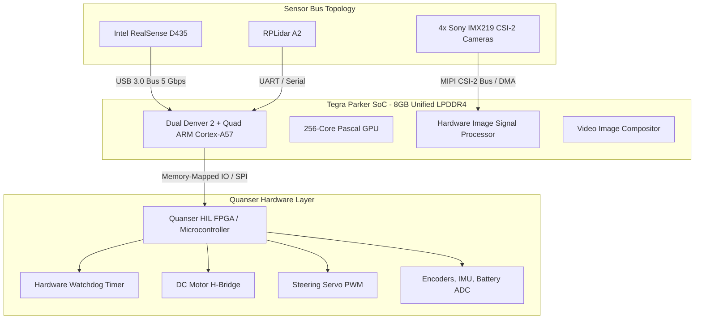
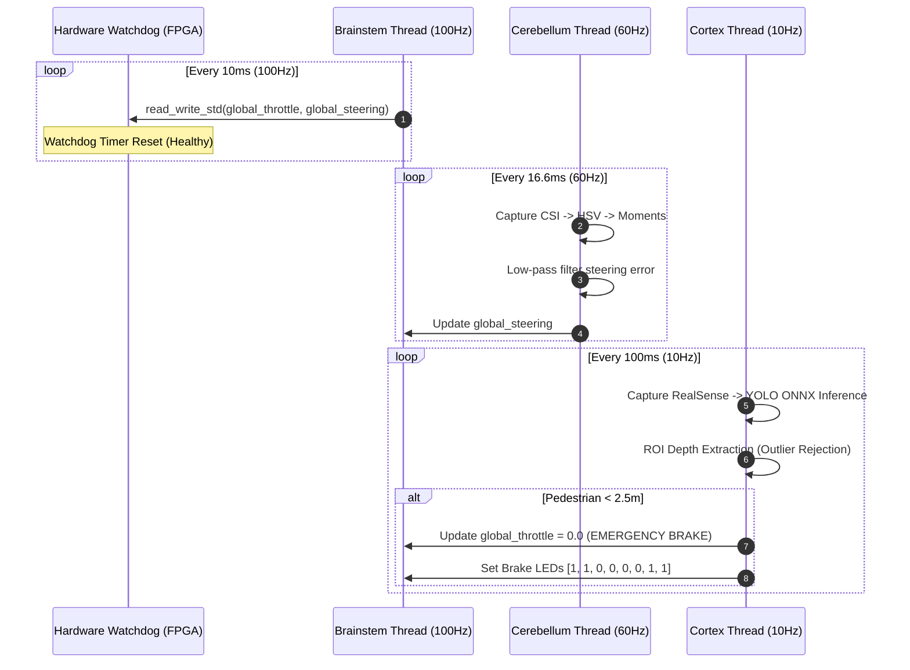

# Quanser QCar: Embedded Systems Engineering Teardown

This document provides a rigorous, hardware-level systems engineering analysis of how the codebase is specifically tailored for the **Quanser QCar1** (NVIDIA Jetson TX2, Quanser HIL DAQ, CSI-2 & RealSense sensors). It dissects the custom hardware APIs, memory management across unified Tegra architecture, and multi-rate concurrency models.

---

## 1. Physical Hardware & Cyber-Physical Constraints

The QCar is not a generic Linux PC; it is a cyber-physical autonomous vehicle with strict real-time and physical constraints:



### Critical Hardware Constraints

| Subsystem | Hardware Spec | Engineering Constraint & Failure Mode |
| :--- | :--- | :--- |
| **Hardware Watchdog** | Onboard QCar DAQ Timer | Must receive `read_write_std()` pulses at $\ge 50\text{--}100\text{ Hz}$. If starved for $> 20\text{--}50\text{ ms}$, hardware safety relays trip and cut power to the drive motor. |
| **Memory Bus (UMA)** | 8GB 128-bit LPDDR4 ($59.7\text{ GB/s}$) | **Unified Memory Architecture:** CPU, GPU, and ISP share the same physical RAM. Dynamic allocations (`malloc`/`free`) and tensor copying cause memory bus saturation, cache thrashing, and high latency jitter. |
| **Tegra CPU Cluster** | 2x Denver 2 + 4x Cortex-A57 | Heterogeneous ARM64 core architecture. Python threads must avoid core hopping and CPU saturation to prevent stalling high-frequency motor control. |
| **RealSense Interface** | USB 3.0 UVC/Depth Stream | Depth and RGB streams compete for USB bus bandwidth. Blocking camera calls (`get_frame()`) can hang the caller if frame delivery is delayed. |
| **CSI Cameras** | 4x MIPI CSI-2 (IMX219) | Routed through Tegra hardware ISP directly into pre-allocated memory buffers. |

---

## 2. Custom Quanser API Deep Dive (HAL, PAL, HIL)

The codebase interfaces with Quanser's proprietary driver stack: **Hardware Abstraction Layer (HAL)**, **Product Abstraction Layer (PAL)**, and the **Hardware-In-the-Loop (HIL)** engine.

### A. The Core Actuation & Telemetry Primitive: `QCar.read_write_std()`

Located in `pal.products.qcar.QCar`, this method is the heartbeat of the vehicle:

```python
myCar = QCar()
myCar.read_write_std(throttle, steering, LEDs)
```

#### Under the Hood:
1. **PWM & Steering Clamping:**
   - Steering is clamped to $[-0.6, 0.6]\text{ rad}$ ($[-34.4^\circ, 34.4^\circ]$) to prevent mechanical linkage binding.
   - Throttle is clamped to $[-pwmLimit, pwmLimit]$ (default: $\pm 0.30$ duty cycle) to prevent motor driver overcurrent.
2. **Digital Output Mapping (LEDs):**
   - Packaged as an 8-element uint8 array controlling indicators, brake lights, reverse lights, and headlights.
3. **Atomic Hardware Transaction:**
   - Calls `self.card.write()` and `self.card.read()` via `quanser.hardware.HIL`.
   - In a single SPI/PCIe memory transaction, the driver writes PWM duty cycles to the FPGA and latches the latest sensor registers:
     - `myCar.motorCurrent`: Analog Channel 0 (ADC reading in Amperes).
     - `myCar.batteryVoltage`: Analog Channel 1 (Voltage monitor for low-battery brownout protection).
     - `myCar.motorEncoder`: Digital encoder quadrature counts.
     - `myCar.motorTach`: Estimated speed in $\text{m/s}$ calculated from encoder ticks.
     - `myCar.gyroscope` & `myCar.accelerometer`: 3-axis IMU readings.

---

### B. The Camera APIs & The Depth Nuance Trap

#### 1. RealSense 3D Vision (`pal.products.qcar.QCarRealSense`)
Inherits from `pal.utilities.vision.Camera3D`, which wraps Quanser's C++ `Video3D` stream engine:

```python
with QCarRealSense(mode="RGB, Depth") as myCam:
    myCam.read_RGB()
    myCam.read_depth(dataMode='PX')  # <-- CRITICAL ARCHITECTURAL DETAIL
```

**The Internal Buffer Distinction:**
In `pal/utilities/vision.py`, Quanser implements two distinct depth paths:
- `dataMode='PX'`: Calls `frame.get_data(self.imageBufferDepthPX)`. Fills a pre-allocated **uint8** buffer ($0\text{--}255$).
- `dataMode='M'`: Calls `frame.get_meters(self.imageBufferDepthM)`. Fills a pre-allocated **float32** buffer (direct metric values).

Quanser's sample educational code used `dataMode='PX'` and divided by `max_distance` purely for `cv2.imshow()`. The author of this project retained `dataMode='PX'` for performance and memory predictability, but engineered the calibrated `depth_scale` parameter in `config.yaml` to convert those raw values back to physical meters.

#### 2. CSI-2 High-Speed Vision (`pal.products.qcar.QCarCameras`)
Controls the 4 surround cameras. Unlike USB cameras, CSI cameras use hardware DMA:
```python
myCSI = QCarCameras(frameWidth=1640, frameHeight=820, frameRate=60, enableFront=True)
myCSI.readAll()
frame = myCSI.csiFront.imageData
```

---

### C. Quanser Digital Signal Processing (`pal.utilities.math.Filter`)

In `qcar1_autonomous.py`, steering output is smoothed using Quanser's coroutine-based digital filter:

```python
from pal.utilities.math import Filter

# Instantiate 1st-order low-pass filter (cutoff: 25 rad/s, sampling period: 0.033s)
steeringFilter = Filter().low_pass_first_order_variable(25, 0.033)
next(steeringFilter)  # Prime the Python generator

# In the 60Hz loop:
filteredSteering = steeringFilter.send((np.clip(rawSteering, -0.5, 0.5), dt))
```

**Engineering Rationale:**
Steering actuators on autonomous vehicles suffer from jitter caused by frame-to-frame computer vision centroid jumping. Passing raw errors directly to the servo burns out the motor and causes violent lateral oscillations. The author used a discrete low-pass filter coroutine that dynamically accounts for variable loop delta time (`dt`).

---

### D. Digital Twin Dualism (`IS_PHYSICAL_QCAR`)

In `pal.products.qcar`, the system dynamically detects its host environment:
```python
IS_PHYSICAL_QCAR = ('nvidia' == os.getlogin()) and ('aarch64' == platform.machine())
```

- **If Physical Hardware (`True`):** Opens HIL card identifier `"0"`.
- **If QLabs Virtual Twin (`False`):** Opens TCP socket `"0@tcpip://localhost:18960?nagle='off'"`, disabling Nagle's algorithm to eliminate network buffering latency, and calls `qlabs_setup.setup()` to initialize Unreal Engine actors.

---

## 3. Memory Awareness on Jetson Unified Memory (UMA)

On standard PCs, CPU memory (RAM) and GPU memory (VRAM) are physically separated by PCIe buses. On the Jetson TX2, both share **8GB of unified LPDDR4**.

```
+-------------------------------------------------------------+
|               8 GB Unified LPDDR4 (59.7 GB/s)               |
+------------------------------+------------------------------+
|     CPU Virtual Memory       |     GPU Virtual Memory       |
|  - Python interpreter        |  - TensorRT Engine Weights   |
|  - Pre-allocated Ring Buffers|  - CUDA Execution Context    |
|  - OS & Drivers              |  - ONNX Runtime Tensor Pool  |
+------------------------------+------------------------------+
           ^                                 ^
           |                                 |
           +======= Shared Memory Bus =======+
                   (Bandwidth Bottleneck)
```

### Memory Engineering Techniques in the Project:

1. **Pre-Allocated Static Frame Buffers (Zero-Allocation Loop):**
   Quanser's PAL initializes frame buffers once at startup:
   ```python
   self.imageBufferRGB = np.zeros((frameHeightRGB, frameWidthRGB, 3), dtype=np.uint8)
   self.imageBufferDepthPX = np.zeros((frameHeightDepth, frameWidthDepth, 1), dtype=np.uint8)
   ```
   During runtime, the C++ library writes frame bytes directly into the pre-allocated numpy array memory block using pointer addressing (`frame.get_data(...)`). This prevents Python's memory allocator from creating and destroying 6MB arrays 60 times a second, which would trigger the garbage collector (GC) and cause frame drops.

2. **Numpy Slicing as Memory Views (Zero-Copy):**
   In `qcar1_autonomous.py`:
   ```python
   croppedRGB = myCSI.csiFront.imageData[524:674, 0:1640]
   ```
   In numpy, basic indexing with slices does not allocate new memory; it creates a **view** sharing the underlying memory buffer with different strides. The 60Hz lane tracker processes only the bottom 150 rows of the image without copying a single pixel.

3. **C-Contiguous Memory Enforcement:**
   In `utils/yolo_onnx.py`:
   ```python
   img = np.ascontiguousarray(img)
   ```
   ONNX Runtime's C++ inference session expects contiguous row-major memory. If an array is non-contiguous (e.g. after transposing `HWC -> CHW`), passing it to C++ forces an internal copy. Calling `ascontiguousarray()` guarantees a deterministic memory layout prior to the inference call.

---

## 4. Multi-Rate Concurrency Architecture (3-Tier Threading)

The most advanced engineering feat in the project is resolving the temporal conflict between **fast hardware control** and **slow deep learning perception**.



### The Three Tiers of Concurrency

| Thread | Frequency | Priority | Hardware Resource | Function |
| :--- | :---: | :---: | :--- | :--- |
| **Brainstem** | **100 Hz** | Hard Real-Time | Quanser HIL DAQ | Feeds the hardware watchdog; handles actuator safety limits; logs battery & motor current. |
| **Cerebellum** | **60 Hz** | Soft Real-Time | CSI-2 Front Camera | High-speed lane tracking; calculates yellow-line centroid moments; runs variable low-pass filter. |
| **Cortex** | **3–10 Hz** | Best Effort | RealSense RGB-D + GPU/CPU | YOLOv5 neural network inference; depth ROI statistics; emergency braking override. |

### How This Overcomes the Python GIL (Global Interpreter Lock)

In standard CPython, multithreading is limited by the GIL. Why does this 3-thread architecture achieve smooth real-time performance on a 6-core ARM CPU?

1. **Quanser Driver Drops the GIL:** `myCar.read_write_std()` delegates to compiled C libraries (`libhil.so`), releasing the GIL during bus I/O.
2. **OpenCV Drops the GIL:** `cv2.cvtColor`, `cv2.moments`, and `cv2.dnn.NMSBoxes` execute in compiled C++ threads, allowing other Python threads to execute concurrently.
3. **ONNX Runtime Drops the GIL:** `session.run()` releases the GIL to its internal OpenMP/threadpool worker threads.
4. **Explicit Thread Yielding:** Both the 100Hz motor thread (`time.sleep(0.01)`) and the perception loop (`time.sleep(0.01)`) call `sleep()`, which voluntarily releases the GIL back to the operating system scheduler.

### Lock-Free Shared State Concurrency
Rather than introducing heavy `threading.Lock` primitives that could cause priority inversion and block the 100Hz motor thread, the author used **atomic global variable swaps**:
```python
# Shared state
global_throttle = 0.10
global_steering = 0.0
global_LEDs = np.array([0, 0, 0, 0, 0, 0, 1, 1])
```
In Python, assigning a reference to a float or numpy array pointer is an atomic bytecode operation (`STORE_NAME` / `STORE_GLOBAL`). The motor thread reads the current pointer without waiting for a lock, guaranteeing it never misses a watchdog deadline.

---

## 5. Summary Checklist: The QCar Systems Engineering Pattern

When engineering on the Quanser QCar or any comparable cyber-physical platform:

1. **Decouple Actuation from Perception:** Never call `read_write_std()` in the same loop as your neural network or camera capture. Use a 100Hz motor feeder thread.
2. **Use Camera Views, Not Copies:** Crop ROI regions using slicing (`image[y1:y2, x1:x2]`) to avoid dynamic memory allocation on unified Tegra RAM.
3. **Filter Actuator Outputs:** Always smooth vision-derived control signals through a digital filter (e.g. `Filter().low_pass_first_order_variable`) to prevent servo gear degradation.
4. **Differentiate Display from Metric Units:** Separate cosmetic scaling (`/ max_distance`) from metric scaling (`* scale`).
5. **Implement Safe Shutdown Sequences:** Always register `finally:` blocks that invoke `myCar.terminate()`, `myCSI.terminate()`, and `myRealSense.terminate()` to guarantee that motors cut power if code crashes.
